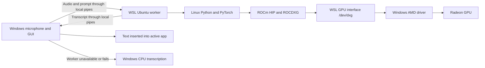

# Speak to Bridge

> **Speak. Bridge. Done.**

An accessible, privacy-conscious dictation application for Windows.

Speak to Bridge records speech on demand, transcribes it locally with
[faster-whisper](https://github.com/SYSTRAN/faster-whisper), and inserts the
result into the application you are using. It was designed around keyboard and
screen-reader access rather than treating accessibility as a later addition.

> **Project status:** Speak to Bridge is a personal, independently developed project.
> It currently supports Windows, English dictation, and the default microphone.

## Why this project exists

Many dictation tools depend on cloud transcription or make their most important
controls difficult to use with a screen reader. Speak to Bridge explores a different
approach: local transcription, predictable keyboard control, persistent user
preferences, and status feedback that works with JAWS.

## Highlights

AMD Strix Halo / Radeon 8060S GPU processing is available through the optional
ROCm backend. See [AMD setup and verification](AMD_SETUP.md). CPU processing
continues to work without the optional runtime. The shared WSL ROCm backend has
been verified on a Ryzen AI Max+ 388 / Radeon 8060S with Tiny, Small and Large v3 models.
These repairs are available in source; the v1.5.0-rc.1 installer predates them.

- **Local transcription:** recorded audio stays on the computer after the
  selected Whisper model has been downloaded.
- **Keyboard-first operation:** a configurable global hotkey starts and stops
  dictation without moving focus away from the current application.
- **Screen-reader feedback:** Runtime Status is keyboard-focusable, exposes its
  current value to accessibility tools, and emits polite status announcements.
- **Optional sound cues:** short, distinct sounds identify recording,
  processing, success, and failure without requiring the user to inspect the
  window. Users can turn every cue off from Settings.
- **Automatic insertion:** completed text is pasted into the active application
  while preserving the user's existing clipboard text.
- **Personal Word Bank:** custom corrections improve names, terminology, and
  phrases that Whisper commonly mishears.
- **Lifetime statistics:** the application tracks the total number of dictated
  words and completed clips across sessions.
- **Safety limits:** recording duration is configurable and independently capped
  in memory to prevent an abandoned recording from growing indefinitely.
- **Windows-aware presentation:** the interface follows native fonts, colours,
  dark mode, high-contrast settings, and focus behaviour.

## Accessibility

Accessibility features include:

- JAWS-readable labels, values, status updates, and keyboard focus order;
- `Alt+S` to move directly to Runtime Status;
- accessible controls for choosing the activation hotkey;
- confirmation before deleting a downloaded model;
- warnings before closing with unsaved Word Bank changes; and
- a single keyboard stop for the overall word and clip count.

Accessibility is an ongoing part of development. Bug reports describing the
screen reader, keyboard sequence, expected result, and actual result are
especially useful.

## Install

Download the current installer from
[GitHub Releases](https://github.com/ShreyBhatt-108/SpeakToBridge/releases/latest),
then run `SpeakToBridge-Setup.exe`.

The current installer is not digitally signed, so Windows may display an
unknown-publisher or SmartScreen warning. Verify that the download came from
this repository's Releases page before running it.

On first transcription, the selected Whisper model is downloaded and stored in
local application data. Transcription can run offline after that model is ready.

## Python and processing backends

The Windows installer bundles its own Python interpreter and dependencies.
You can use the app with no Python installed, or alongside another Python
version. Installing Python 3.15 does not change the app's bundled Python.
Source development and GPU environments must still use versions supported by
their native packages; arbitrary Python versions cannot share the same binaries.

In Settings > Model, **Processing device** is your preference, **Loaded backend**
is the runtime actually loaded, and **Last transcription** shows the CPU or GPU
that produced the last successful transcript in this session. The latter also
includes microphone tests and remains visible during the next recording. It
starts empty each session rather than claiming an untested GPU is already active.
Automatic mode can fall back to CPU, so selecting GPU is not proof of GPU use.
These indicators do not add anything to the text inserted into another app.

### How WSL connects the Windows app to AMD ROCm

WSL2 runs a real Linux kernel in a lightweight virtual machine managed by
Windows. Ubuntu is the Linux operating system inside it. The Windows GUI stays
native: it handles microphone recording, hotkeys, silence filtering, Word Bank
corrections and text insertion. Only the AMD inference worker runs in Ubuntu.



`wsl.exe` starts the worker using a shared interpreter at `/opt/amd-ai/bin/python`.
Local stdin/stdout pipes carry audio, language and the Word Bank prompt as JSON;
there is no cloud transcription service or local network listener. PyTorch asks
ROCm/HIP to execute model operations. AMD's ROCDXG routes those requests through
Microsoft's DXCore and `/dev/dxg` to the existing Windows GPU driver and physical
Radeon. The Linux kernel does not need a separate native amdgpu kernel driver.

The Linux environment contains ROCm 7.14.1, PyTorch 2.12.0+rocm7.14.1 with gfx1151
packages and Transformers 4.57.6. This differs from the original Windows bundle's
ROCm 7.2.1/PyTorch 2.9.1. Native Windows DLLs and Linux shared libraries are different
binaries: using the Linux runtime avoids loading the unsigned Windows ROCm DLL
that Smart App Control rejected on the tested laptop. Smart App Control stays on.

The first GPU preparation downloads the selected model's required weights.
Large v3's standard 16-bit weight file is about 3.09 GB: approximately 1.55
billion parameters at two bytes each. Quantized versions can be smaller, but
this PyTorch/ROCm backend currently uses FP16. The downloader selects the needed
`model.safetensors` file and excludes redundant FP32 copies. Runtime Status
distinguishes downloading from loading cached weights into GPU memory.

The WSL GPU worker pauses its inference process after synchronizing completed
GPU work, and wakes it for the next recording. This retains loaded weights while
preventing ROCm background threads from consuming CPU continuously between
recordings. The lightweight supervisor remains available; quitting the app
closes both processes. These controls apply to SpeakToBridge's worker, not other
AI experiments using the shared environment.

Model preparation reports cache checks, PyTorch startup, weight loading and GPU
transfer separately. On Linux ROCm, parameters are packed into one GPU transfer
instead of hundreds of separate allocations and copies. This uses temporary
extra RAM during loading and creates no additional model files. On the tested
8060S, Large v3 preparation improved from about 51 seconds to 35 seconds, while
an already-loaded transcription after an idle pause took about 2 seconds.
Cache enumeration itself took about 0.07 seconds. Cold startup still needs to
start PyTorch and load the 3.09 GB model; these figures are measurements on one
laptop, not guaranteed timings.

Feedback sounds use the latest event: a completion cue interrupts obsolete
processing feedback immediately instead of waiting in a queue. The completion
cue is a 450 ms WAV excerpt of the existing tone, played asynchronously after
successful text insertion; its long decay and MP3 initialization are removed. The sound preference is
preserved. The batching approach follows [AMD HIP performance guidance](https://rocm.docs.amd.com/projects/HIP/en/docs-6.2.2/how-to/performance_guidelines.html).

Windows files are accessible under `/mnt/c`. GPU Whisper weights are regular
files in the existing app cache's `models/openai-whisper-<size>` directories, so a
later native AMD setup can reuse them. CPU CTranslate2 weights have a different
format. Settings and Word Bank remain in Windows application data.

For installation and opt-in configuration, see [AMD_SETUP.md](AMD_SETUP.md).
Keep the configured worker checkout path available. WSL configurations are per
Windows user; another user's installation needs its own setup. The standard CPU
installer still needs neither WSL nor a system Python installation.

To reuse the same environment for local AI experiments, run this in PowerShell:

```powershell
wsl -d Ubuntu-24.04
```

Then in Ubuntu:

```bash
source /opt/amd-ai/bin/activate
python -c "import torch; print(torch.cuda.get_device_name(0))"
```

PyTorch uses its `torch.cuda` API for AMD HIP devices as well. Windows Python and
Linux Python have separate packages; activate this Linux environment for ROCm
experiments. To reuse downloaded Whisper weights with Transformers, load their
local `/mnt/c/.../SpeakToBridge/models/openai-whisper-small` directory directly.
Later native Windows ROCm is possible with a compatible supported runtime and
Windows trust requirements resolved; copying Linux packages into Windows will
not provide a native installation.

References: [Microsoft WSL FAQ](https://learn.microsoft.com/en-us/windows/wsl/faq),
[AMD WSL/ROCDXG guide](https://rocm.docs.amd.com/projects/radeon-ryzen/en/docs-7.2.1/docs/install/installrad/wsl/howto_wsl.html).

## Everyday use

1. Open **Speak to Bridge Settings** and choose an activation hotkey.
2. Place the cursor in the application where text should appear.
3. Press the activation hotkey to begin recording.
4. Press it again to stop, transcribe, and insert the text.
5. Press `Ctrl+F8` to have the Windows system voice read the most recent
   transcript aloud.

The default recording limit is 300 seconds. It can be set from 30 to 3,600
seconds under **Show More Settings > Recording Limit**.

The **Play sound effects** checkbox controls the recording, processing, success,
and failure cues. It is enabled by default, takes effect immediately, and is
remembered across restarts. Runtime Status continues to provide accessible text
feedback when sounds are disabled.

### Spoken formatting commands

- Say `new line` to insert a line break. Say it twice for a blank line between
  paragraphs.
- Say `start list`, dictate items separated by commas, semicolons, `and`, or
  `then`, and say `end list` to create bullets.
- For a numbered list, use sequential markers from one through nine between
  `start list` and `end list`, for example: `one, first item, two, second item`.
- Use `open quote` and `close quote` (or `quote` and `unquote`) around quoted
  text.

Whisper may infer punctuation around these phrases; Speak to Bridge removes
that command punctuation before formatting. Editing phrases such as `scratch
that`, `delete that`, and `undo` are not currently implemented.

### Word Bank

Enter one correction per line:

```text
heard_word = CorrectWord
```

Save the Word Bank to apply those corrections to future transcripts.

## Privacy and local data

Speech is transcribed locally after the selected model has been downloaded.
Read-aloud text is passed to Windows PowerShell through standard input rather
than being placed on the process command line.

Settings, models, logs, the Word Bank, and lifetime statistics are stored under:

```text
%LOCALAPPDATA%\SpeakToBridge
```

Uninstalling or upgrading the program preserves this folder. Delete it manually
only when you intentionally want to remove all Speak to Bridge user data.

## Run from source

Python 3.11 or newer is required.

```powershell
git clone https://github.com/ShreyBhatt-108/SpeakToBridge.git
cd SpeakToBridge
python -m venv .venv
.\.venv\Scripts\Activate.ps1
python -m pip install --require-hashes -r requirements.lock.txt
python -m SpeakToBridge
```

## Build the application

Run the release build from PowerShell:

```powershell
.\build.ps1
```

The script installs the hash-locked runtime and build dependencies, packages the
application with PyInstaller, and uses Inno Setup 6 when available.

Build outputs:

- `dist\SpeakToBridge\SpeakToBridge.exe` — portable folder build;
- `dist\SpeakToBridge-Setup.exe` — Windows installer.

`SpeakToBridge/constants.py` is the single source of the application version. To
Authenticode-sign a release, install the Windows SDK and set
`SPEAK_TO_BRIDGE_SIGNING_CERT_SHA1` to the thumbprint of an available code-signing
certificate before running the build.

## Project structure

```text
SpeakToBridge/
  app.py             Application startup and single-instance handling
  controller.py      Dictation workflow and application coordination
  audio.py           Microphone recording
  ui.py              Settings window and accessible controls
  config.py          Validated user settings
  stats_store.py     Persistent word and clip totals
  sound_feedback.py  Non-visual status cues
build.ps1             Reproducible Windows release build
installer.iss         Inno Setup installer definition
```

The more detailed `CODE_WALKTHROUGH_LOCAL.md` is intentionally ignored by Git
because it is the author's private learning documentation.

## Release notes

Version 1.4.0 adds a persistent, accessible setting for disabling every sound
cue while retaining Runtime Status feedback. It also closes a running tray
instance before uninstalling, preventing locked program files and incomplete
removal notices while continuing to preserve user data. Version 1.3.1 made
spoken list and line-break commands resilient to punctuation inferred by
Whisper. Version 1.3.0 introduced the Speak to Bridge name and “Speak. Bridge.
Done.” welcome message. See
[all releases](https://github.com/ShreyBhatt-108/SpeakToBridge/releases) for
downloadable builds and release history.

## Authorship and AI assistance

Speak to Bridge was conceived, directed, tested, and published by **Shrey Bhatt**.
OpenAI Codex assisted with code review, implementation, documentation, testing,
and release preparation. Shrey Bhatt remains responsible for the project's
design decisions, quality, security, licensing, and published releases.

## Copyright and licensing

Copyright © 2026 Shrey Bhatt. All rights reserved.

The Speak to Bridge source code is publicly viewable, but no permission to copy,
modify, or redistribute it is granted except where required by the licenses of
its third-party components. See [LICENSE](LICENSE) for the project terms and
[THIRD_PARTY_ASSETS.md](THIRD_PARTY_ASSETS.md) for bundled sound provenance.

Python packages and other third-party components remain subject to their own
licenses. The names and trademarks of third parties belong to their respective
owners.
