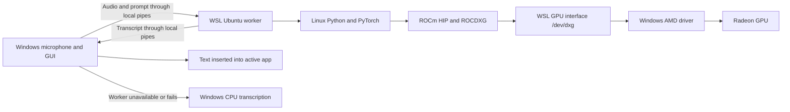

# Speak to Bridge

> **Speak. Bridge. Done.**

An accessible, local dictation and meeting transcription application for Windows.

Speak to Bridge records speech on demand, transcribes it locally with
[faster-whisper](https://github.com/SYSTRAN/faster-whisper), and inserts the
result into the application you are using. It was designed around keyboard and
screen-reader access rather than treating accessibility as a later addition.

> **Project status:** Speak to Bridge is a personal, independently developed project.
> It currently supports Windows, English dictation, and the default microphone.

## Why this project exists

Many dictation tools depend on cloud transcription or make their most important
controls difficult to use with a screen reader. Speak to Bridge explores a different
approach: local transcription, predictable keyboard control, persistent user
preferences, and status feedback that works with JAWS.

## Highlights

AMD Strix Halo / Radeon 8060S GPU processing is available through the optional
ROCm backend. See [AMD setup and verification](AMD_SETUP.md). CPU processing
continues to work without the optional runtime. Native Windows ROCm is the default AMD path and has passed packaged Large v3
transcription on a Ryzen AI Max+ 388 / Radeon 8060S. WSL remains an optional
alternative and has passed Tiny, Small, Medium and Large v3 GPU tests.
The v1.6.0-rc.1 release provides standard CPU and Strix Halo installers, both
including meeting transcription and local AI notes.

- **Local transcription:** recorded audio stays on the computer after the
  selected Whisper model has been downloaded.
- **Keyboard-first operation:** a configurable global hotkey starts and stops
  dictation without moving focus away from the current application.
- **Screen-reader feedback:** Runtime Status is keyboard-focusable, exposes its
  current value to accessibility tools, and emits polite status announcements.
- **Optional sound cues:** short, distinct sounds identify recording,
  processing, success, and failure without requiring the user to inspect the
  window. Users can turn every cue off from Settings.
- **Automatic insertion:** completed text is pasted into the active application
  while preserving the user's existing clipboard text.
- **Personal Word Bank:** custom corrections improve names, terminology, and
  phrases that Whisper commonly mishears.
- **Lifetime statistics:** the application tracks the total number of dictated
  words and completed clips across sessions.
- **Safety limits:** recording duration is configurable and independently capped
  in memory to prevent an abandoned recording from growing indefinitely.
- **Windows-aware presentation:** the interface follows native fonts, colours,
  dark mode, high-contrast settings, and focus behaviour.

## Meetings and automatic notes

Open **Meetings** to record the default microphone for a long session, or choose
**Transcribe Audio File**. Meeting mode supports recordings longer than five
minutes and saves timestamped transcript sections as processing completes.
**Stop Meeting** finishes pending transcription and creates an AI draft containing
a summary, decisions and action items. Review the draft: automatic notes can
still miss or misunderstand speech. Edit notes in the app and export notes plus
the transcript as Markdown or plain text. Meetings never paste into another app.

The notes engine is a private, CPU-only llama.cpp worker. Its Qwen3 1.7B
Q4_K_M model downloads once (about 1.28 GB) into the app's model cache; subsequent
notes work offline. It does not require PyTorch, a GPU, or a separately installed
Python. Notes generation uses at most four CPU threads. Whisper transcription
continues to use your selected CPU or Radeon backend. The model manager can delete
the notes model when no meeting is running; it downloads again when needed.

Meeting files live under `%LOCALAPPDATA%\SpeakToBridge\meetings`.
Processed microphone audio is deleted by default; enable **Keep audio** before
recording to retain it. Failed or interrupted chunks are retained for recovery.
Imported audio files are left unchanged. Transcripts and editable notes remain
on this computer and are not uploaded to an AI service.

Dictation remains separate: it stops after **30 seconds without speech**, with
its configured total recording limit as an additional safeguard. Meetings do not
use that silence timeout. The selected dictation model prepares in the background
on launch, before the first recording; GPU preparation can take time. The hotkey
status tells you when preparation is complete.

## Accessibility

Accessibility features include:

- JAWS-readable labels, values, status updates, and keyboard focus order;
- `Alt+S` to move directly to Runtime Status;
- accessible controls for choosing the activation hotkey;
- confirmation before deleting a downloaded model;
- warnings before closing with unsaved Word Bank changes; and
- a single keyboard stop for the overall word and clip count.

Accessibility is an ongoing part of development. Bug reports describing the
screen reader, keyboard sequence, expected result, and actual result are
especially useful.

## Install

Download the current installer from
[GitHub Releases](https://github.com/ShreyBhatt-108/SpeakToBridge/releases/tag/v1.6.0-rc.1),
then choose the appropriate published installer:

- `SpeakToBridge-Setup.exe`: standard x64 build for Intel or AMD CPU processing
  and an existing compatible NVIDIA runtime. It includes no GPU development toolkit.
- `SpeakToBridge-CUDA-Setup.exe`: bundles NVIDIA CUDA 12 / cuDNN 9 inference
  DLLs, with CPU fallback when a compatible NVIDIA GPU/driver is unavailable.
- Hardware-specific `SpeakToBridge-AMD-gfxNNNN-Setup.exe` packages include native
  Windows ROCm/PyTorch and isolated CPU fallback for the named GPU target.
- `SpeakToBridge-AMD-StrixHalo-Setup.exe`: smaller AMD package for gfx1151
  (including Radeon 8060S), with the same runtime and CPU fallback.

The universal AMD build is for local testing: its current 2.93 GB installer
exceeds GitHub's 2 GiB per-asset limit. Published AMD builds must use a specific
hardware target; Strix Halo is the candidate tested on this laptop.

All variants bundle Python 3.14.8 and preserve settings, Word Bank and downloaded
models. Users need no installed Python; other system Python versions do not
affect the app. GPU drivers remain system prerequisites for GPU acceleration.
The v1.6.0-rc.1 release provides the standard CPU and Strix Halo installers.
The CUDA package remains a local candidate and is excluded from this release.
Artifact hashes, checks and remaining hardware coverage are in
[release validation](RELEASE_VALIDATION.md).

The current installer is not digitally signed, so Windows may display an
unknown-publisher or SmartScreen warning. Smart App Control may block unsigned
application or runtime files outright; protected-machine distribution still
needs trusted signing and validation. Verify that the download came from
this repository's Releases page before running it.

On first transcription, the selected Whisper model is downloaded and stored in
local application data. Transcription can run offline after that model is ready.

### CPU compatibility and validation

The standard build uses CTranslate2's x86-64 CPU backend, which supports Intel
and AMD CPUs with SSE 4.1 or newer and selects appropriate instruction sets at
runtime. See [CTranslate2 hardware support](https://opennmt.net/CTranslate2/hardware_support.html).
It does not require an AMD graphics card, WSL, a system Python or GPU packages.

For this candidate, all 68 regression tests passed in both a clean CPU-only
build environment and the AMD build overlay. Packaged Tiny/Small/Medium CPU
transcription, automatic CPU selection without PyTorch, the generic CPU path,
a forced MKL backend check, and a 38.79-second recording passed on the AMD
laptop. The forced MKL check is not a physical Intel-machine test. This exact
candidate still needs an Intel hardware smoke test; earlier Intel results do
not establish validation of a newly built binary. No claim of universal hardware
or battery-life validation is made.

The AMD build now isolates CPU inference before the first GPU import, avoiding
an OpenMP crash when switching CPU → AMD → CPU. Switching models and closing
the app explicitly release CPU workers. Installer upgrades request a graceful
shutdown and keep the user-data directory outside the replaced application.

## Python and processing backends

The Windows installer bundles its own Python interpreter and dependencies.
You can use the app with no Python installed, or alongside another Python
version. Installing Python 3.15 does not change the app's bundled Python.
Source development and GPU environments must still use versions supported by
their native packages; arbitrary Python versions cannot share the same binaries.

In Settings > Model, **Processing device** is your preference, **Loaded backend**
is the runtime actually loaded, and **Last transcription** shows the CPU or GPU
that produced the last successful transcript in this session. The latter also
includes microphone tests and remains visible during the next recording. It
starts empty each session rather than claiming an untested GPU is already active.
Automatic mode can fall back to CPU, so selecting GPU is not proof of GPU use.
These indicators do not add anything to the text inserted into another app.

### Native Windows AMD processing

The Windows AMD build runs Whisper through bundled PyTorch and ROCm directly
on the Radeon; Ubuntu, a Linux worker checkout, Lemonade and system Python are
not required. Automatic GPU mode selects native ROCm unless a user explicitly
enables `wsl-runtime.json`. To switch an existing WSL setup to native Windows,
set its `enabled` field to `false` and restart the app.

Use Windows-readable Transformers weights in `%LOCALAPPDATA%\SpeakToBridge\models`.
Regular `openai-whisper-<size>` folders and complete Hugging Face snapshot caches
are recognized offline. Existing weights can be hash-verified and moved between
runtimes without downloading again. This folder can also be used as a local
model source by the shared Windows Python environment for experiments.

On the tested laptop, native Large v3 preparation including kernel warm-up took
11.5 seconds; the first and repeated transcriptions of a 6.465-second test clip
took 1.5 and 1.4 seconds. The native process used 0.00 CPU seconds during a
10-second idle check. These are individual tests, not a controlled power study;
no battery-life advantage over WSL has been established. Preparation starts
during recording, and inference retains the FP16 model and four-beam decoding.
CPU fallback stays isolated from ROCm's OpenMP runtime.

Local v1.5.1-rc.3 installers contain these changes; they have not been uploaded
as a public release. The tested laptop has Smart App Control disabled
by its owner. Distribution still requires trusted signing of the application
and runtime binaries, plus installer testing with that protection enabled.

### How WSL connects the Windows app to AMD ROCm

WSL2 runs a real Linux kernel in a lightweight virtual machine managed by
Windows. Ubuntu is the Linux operating system inside it. The Windows GUI stays
native: it handles microphone recording, hotkeys, silence filtering, Word Bank
corrections and text insertion. Only the AMD inference worker runs in Ubuntu.



`wsl.exe` starts the worker using a shared interpreter at `/opt/amd-ai/bin/python`.
Local stdin/stdout pipes carry audio, language and the Word Bank prompt as JSON;
there is no cloud transcription service or local network listener. PyTorch asks
ROCm/HIP to execute model operations. AMD's ROCDXG routes those requests through
Microsoft's DXCore and `/dev/dxg` to the existing Windows GPU driver and physical
Radeon. The Linux kernel does not need a separate native amdgpu kernel driver.

The Linux environment contains ROCm 7.14.1, PyTorch 2.12.0+rocm7.14.1 with gfx1151
packages and Transformers 4.57.6. This differs from the original Windows bundle's
ROCm 7.2.1/PyTorch 2.9.1. Native Windows DLLs and Linux shared libraries are different
binaries: using the Linux runtime avoids loading the unsigned Windows ROCm DLL
that Smart App Control rejected on the tested laptop. Smart App Control stays on.

The first GPU preparation downloads the selected model's required weights.
Large v3's standard 16-bit weight file is about 3.09 GB: approximately 1.55
billion parameters at two bytes each. Quantized versions can be smaller, but
this PyTorch/ROCm backend currently uses FP16. The downloader selects the needed
`model.safetensors` file and excludes redundant FP32 copies. Runtime Status
distinguishes downloading from loading cached weights into GPU memory.

The WSL GPU worker pauses its inference process after synchronizing completed
GPU work, and wakes it for the next recording. This retains loaded weights while
preventing ROCm background threads from consuming CPU continuously between
recordings. The lightweight supervisor remains available; quitting the app
closes both processes. These controls apply to SpeakToBridge's worker, not other
AI experiments using the shared environment.

Opening the GUI imports neither CPU nor GPU inference libraries and does not
start WSL. CPU inference is loaded only for CPU mode or fallback. Windows GPU
mode uses standalone, single-threaded ONNX silence filtering, without importing
CTranslate2 or PyTorch into the GUI. On the tested laptop, launch memory fell
from about 1.7 GB to 106 MB; packaged GUI imports took 0.15 seconds.

Preparation starts in the background when the first recording begins, sharing
one model load with transcription. GPU kernel warm-up happens before reporting
Model Ready. Subsequent recordings reuse that loaded model. Runtime Status
reports actual preparation stages, rather than repeating a ready check every
time. With Linux model storage, Large v3 preparation including GPU warm-up took
about 20 seconds. A repeated 6.465-second English test clip took about 1.2 seconds
to transcribe. These are individual measurements, not guarantees for every
recording or a reboot. Large v3 still needs a first preparation each app session.

On Linux ROCm, parameters are packed into one GPU transfer instead of hundreds
of separate allocations and copies. This uses temporary extra RAM and creates
no additional model files.

Feedback sounds use the latest event: a completion cue interrupts obsolete
processing feedback immediately instead of waiting in a queue. The completion
cue is a 450 ms WAV excerpt of the existing tone, played asynchronously after
successful text insertion; its long decay and MP3 initialization are removed. The sound preference is
preserved. The batching approach follows [AMD HIP performance guidance](https://rocm.docs.amd.com/projects/HIP/en/docs-6.2.2/how-to/performance_guidelines.html).

The recommended WSL GPU cache is `/opt/amd-ai-models`, containing regular
`openai-whisper-<size>` directories and any existing Hugging Face snapshot caches.
The worker recognizes complete legacy snapshots directly, without downloading
another copy or querying the network. Set `gpu_cache` in `wsl-runtime.json` to use
Linux storage; omitting it retains the legacy Windows cache location. Linux
storage avoids the mounted-Windows filesystem translation overhead while still
using the same physical SSD. WSL stores its native ext4 filesystem inside a
virtual disk. See [Microsoft's filesystem guidance](https://learn.microsoft.com/en-us/windows/wsl/filesystems).

During earlier WSL testing, GPU caches were moved into Ubuntu after hash
verification. They have since been moved back into Windows for native ROCm,
with the Ubuntu copies removed so there is one shared copy. Settings, Word Bank and CTranslate2 CPU
weights remain in Windows application data. Windows keeps only a small GPU
cache manifest at `models/.wsl-models.json`, so listing models does not start
Ubuntu or read model weights. The app can delete listed Linux caches through the
configured worker. Native Windows inference needs a Windows-readable model
location; the same weights can be relocated again when switching runtimes.

For installation and opt-in configuration, see [AMD_SETUP.md](AMD_SETUP.md).
Keep the configured worker checkout path available. WSL configurations are per
Windows user; another user's installation needs its own setup. The standard CPU
installer still needs neither WSL nor a system Python installation.

To reuse the same environment for local AI experiments, run this in PowerShell:

```powershell
wsl -d Ubuntu-24.04
```

Then in Ubuntu:

```bash
source /opt/amd-ai/bin/activate
python -c "import torch; print(torch.cuda.get_device_name(0))"
```

PyTorch uses its `torch.cuda` API for AMD HIP devices as well. Windows Python and
Linux Python have separate packages; activate this Linux environment for ROCm
experiments. To reuse downloaded Whisper weights with Transformers, load their
local `/opt/amd-ai-models/openai-whisper-small` directory directly.
Later native Windows ROCm is possible with a compatible supported runtime and
Windows trust requirements resolved; copying Linux packages into Windows will
not provide a native installation.

References: [Microsoft WSL FAQ](https://learn.microsoft.com/en-us/windows/wsl/faq),
[AMD WSL/ROCDXG guide](https://rocm.docs.amd.com/projects/radeon-ryzen/en/docs-7.2.1/docs/install/installrad/wsl/howto_wsl.html).

## Everyday use

1. Open **Speak to Bridge Settings** and choose an activation hotkey.
2. Place the cursor in the application where text should appear.
3. Press the activation hotkey to begin recording.
4. Press it again to stop, transcribe, and insert the text.
5. Press `Ctrl+F8` to have the Windows system voice read the most recent
   transcript aloud.

The default recording limit is 300 seconds. It can be set from 30 to 3,600
seconds under **Show More Settings > Recording Limit**.

The **Play sound effects** checkbox controls the recording, processing, success,
and failure cues. It is enabled by default, takes effect immediately, and is
remembered across restarts. Runtime Status continues to provide accessible text
feedback when sounds are disabled.

### Spoken formatting commands

- Say `new line` to insert a line break. Say it twice for a blank line between
  paragraphs.
- Say `start list`, dictate items separated by commas, semicolons, `and`, or
  `then`, and say `end list` to create bullets.
- For a numbered list, use sequential markers from one through nine between
  `start list` and `end list`, for example: `one, first item, two, second item`.
- Use `open quote` and `close quote` (or `quote` and `unquote`) around quoted
  text.

Whisper may infer punctuation around these phrases; Speak to Bridge removes
that command punctuation before formatting. Editing phrases such as `scratch
that`, `delete that`, and `undo` are not currently implemented.

### Word Bank

Enter one correction per line:

```text
heard_word = CorrectWord
```

Save the Word Bank to apply those corrections to future transcripts.

## Privacy and local data

Speech is transcribed locally after the selected model has been downloaded.
Read-aloud text is passed to Windows PowerShell through standard input rather
than being placed on the process command line.

Settings, models, logs, the Word Bank, and lifetime statistics are stored under:

```text
%LOCALAPPDATA%\SpeakToBridge
```

Uninstalling or upgrading the program preserves this folder. Delete it manually
only when you intentionally want to remove all Speak to Bridge user data.

## Run from source

Python 3.11 or newer is required.

```powershell
git clone https://github.com/ShreyBhatt-108/SpeakToBridge.git
cd SpeakToBridge
python -m venv .venv
.\.venv\Scripts\Activate.ps1
python -m pip install --require-hashes -r requirements.lock.txt
python -m SpeakToBridge
```

## Build the application

Run the release build from PowerShell:

```powershell
.\build.ps1
```

The script installs the hash-locked runtime and build dependencies, packages the
application with PyInstaller, and uses Inno Setup 6 when available.

Build outputs:

- `dist\SpeakToBridge\SpeakToBridge.exe` — portable folder build;
- `dist\SpeakToBridge-Setup.exe` — Windows installer.

`SpeakToBridge/constants.py` is the single source of the application version. To
Authenticode-sign a release, install the Windows SDK and set
`SPEAK_TO_BRIDGE_SIGNING_CERT_SHA1` to the thumbprint of an available code-signing
certificate before running the build.

## Project structure

```text
SpeakToBridge/
  app.py             Application startup and single-instance handling
  controller.py      Dictation workflow and application coordination
  audio.py           Microphone recording
  ui.py              Settings window and accessible controls
  config.py          Validated user settings
  stats_store.py     Persistent word and clip totals
  sound_feedback.py  Non-visual status cues
build.ps1             Reproducible Windows release build
installer.iss         Inno Setup installer definition
```

The more detailed `CODE_WALKTHROUGH_LOCAL.md` is intentionally ignored by Git
because it is the author's private learning documentation.

## Release notes

Version 1.4.0 adds a persistent, accessible setting for disabling every sound
cue while retaining Runtime Status feedback. It also closes a running tray
instance before uninstalling, preventing locked program files and incomplete
removal notices while continuing to preserve user data. Version 1.3.1 made
spoken list and line-break commands resilient to punctuation inferred by
Whisper. Version 1.3.0 introduced the Speak to Bridge name and “Speak. Bridge.
Done.” welcome message. See
[all releases](https://github.com/ShreyBhatt-108/SpeakToBridge/releases) for
downloadable builds and release history.

## Authorship and AI assistance

Speak to Bridge was conceived, directed, tested, and published by **Shrey Bhatt**.
OpenAI Codex assisted with code review, implementation, documentation, testing,
and release preparation. Shrey Bhatt remains responsible for the project's
design decisions, quality, security, licensing, and published releases.

## Copyright and licensing

Copyright © 2026 Shrey Bhatt. All rights reserved.

The Speak to Bridge source code is publicly viewable, but no permission to copy,
modify, or redistribute it is granted except where required by the licenses of
its third-party components. See [LICENSE](LICENSE) for the project terms and
[THIRD_PARTY_ASSETS.md](THIRD_PARTY_ASSETS.md) for bundled sound provenance.

Python packages and other third-party components remain subject to their own
licenses. The names and trademarks of third parties belong to their respective
owners.

## Accessibility, security and package size review

The rc.3 update keeps the same status-announcement events but shortens their text. Hardware/runtime
strings and repeated totals are omitted from automatic speech; backend details
remain inspectable. Microphone checks show a summary with optional details.
Model deletion runs in the background, protects every layout of the active
model, requires confirmation and rejects links/path escapes. Your settings,
Word Bank and existing models are preserved.

The inference bundle omits SDK compiler tools, headers and static development
libraries; runtime DLLs and kernels stay intact. The shared Windows/WSL AI
environments are not removed. See [security review](SECURITY_REVIEW.md) for audit
results and compatibility checks. The old advisory-flagged AMD runtime is
replaced by official stable PyTorch 2.14.0+rocm10.1.0 and Transformers 5.20.0.
The pinned CPU, AMD model/PyTorch and NVIDIA package checks reported no known
findings. GPU and CPU fallback remain verified separately; NVIDIA hardware and
other Radeon models still need device-specific validation.

Windows kernel warm-up bounds its synthetic silence generation to two tokens;
real dictation keeps its normal beam/length settings. CUDA inference is isolated
so a failed native GPU worker can retry the original recording on CPU. A Windows
CI workflow runs the regression suite and frozen CPU transcription with Python
removed from PATH. See [release validation](RELEASE_VALIDATION.md) for artifact
hashes, sizes and measured limits.
